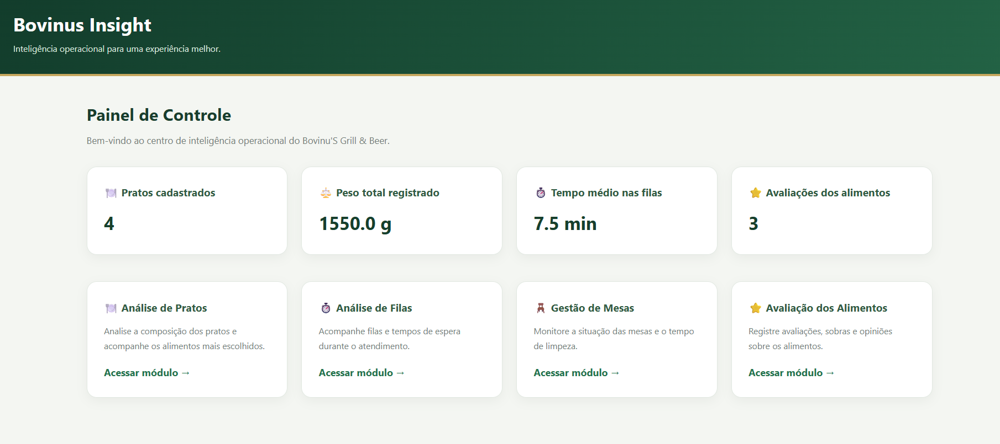
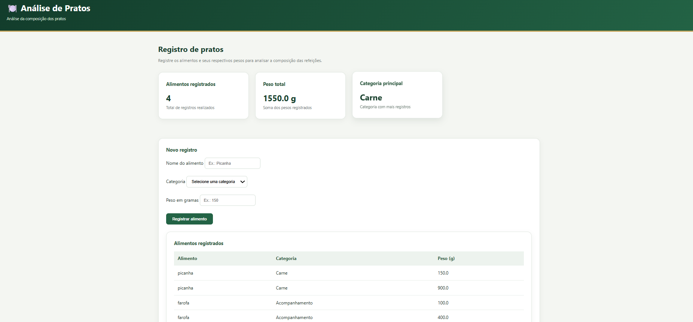
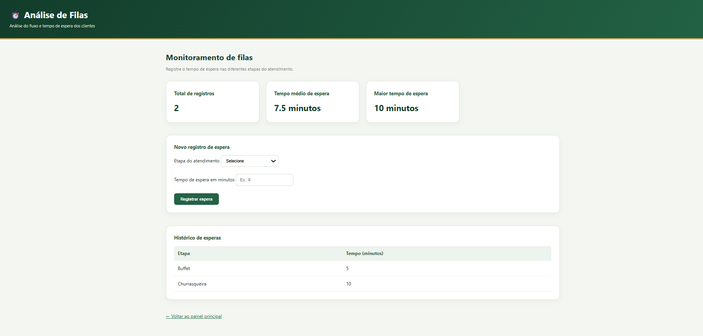
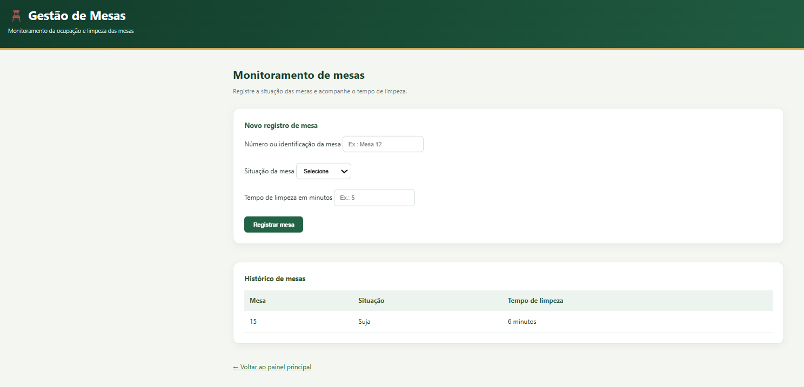
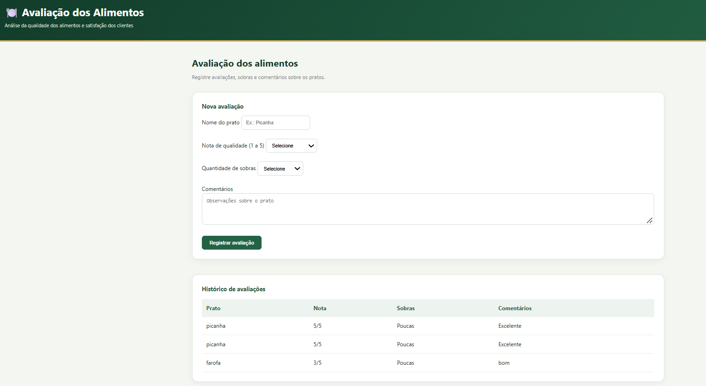

# 🐂 Bovinus Insight

### Inteligência operacional para uma experiência melhor.

Sistema desenvolvido para o desafio Hackathon FMU & Bovinu’S Grill & Beer — Unidade Augusta.

## 📌 Sobre o projeto

O Bovinus Insight é uma solução desenvolvida para apoiar o monitoramento operacional de restaurantes, oferecendo informações sobre pratos, filas, mesas e qualidade dos alimentos.

O objetivo é facilitar a identificação de pontos de melhoria durante o atendimento e contribuir para uma experiência melhor dos clientes.

## 🎯 Problema identificado

Durante o serviço de almoço, alguns desafios podem impactar a operação:

- Dificuldade em acompanhar a composição dos pratos.
- Filas e tempos de espera nas etapas do atendimento.
- Demora na identificação e limpeza de mesas.
- Necessidade de acompanhar a qualidade dos alimentos e as sobras.

## 💡 Solução proposta

O Bovinus Insight reúne quatro módulos de monitoramento:

### 1. Análise de Pratos
Registra alimentos, categorias e pesos, permitindo acompanhar a composição dos pratos.

### 2. Análise de Filas
Registra os tempos de espera no buffet, na churrasqueira e no atendimento nas mesas.

### 3. Gestão de Mesas
Permite registrar a situação das mesas, identificando se estão ocupadas, sujas, em limpeza ou disponíveis.

### 4. Avaliação dos Alimentos
Registra notas de qualidade, quantidade de sobras e comentários sobre os alimentos.

## 📊 Painel principal

O sistema apresenta indicadores para facilitar a visualização das informações registradas nos módulos, incluindo:

- Quantidade de pratos cadastrados.
- Peso total registrado.
- Tempo médio nas filas.
- Quantidade de avaliações dos alimentos.

## 🛠️ Tecnologias utilizadas

- **Python:** linguagem principal do projeto.
- **Flask:** desenvolvimento da aplicação web.
- **HTML5:** estrutura das páginas.
- **CSS3:** estilização e identidade visual.
- **JavaScript:** funcionalidades interativas.
- **Chart.js:** criação de gráficos.
- **SQLite:** armazenamento dos registros.

## 📁 Estrutura do projeto

```text
bovinus_insight/
│
├── app.py
├── database.py
├── bovinus.db
├── requirements.txt
├── README.md
├── .gitignore
│
├── templates/
│   ├── dashboard.html
│   ├── pratos.html
│   ├── filas.html
│   ├── mesas.html
│   └── qualidade.html
│
└── static/
    └── css/
        └── style.css
```

## ▶️ Como executar o projeto

### 1. Clonar o repositório

```bash
git clone https://github.com/luansilvams06-cmyk/bovinus_insight.git
```

### 2. Entrar na pasta

```bash
cd bovinus_insight
```

### 3. Criar ambiente virtual

```bash
py -m venv .venv
```

### 4. Ativar o ambiente virtual

No Windows PowerShell:

```powershell
.venv\Scripts\Activate.ps1
```

### 5. Instalar as dependências

```bash
py -m pip install -r requirements.txt
```

### 6. Executar a aplicação

```bash
py app.py
```

Depois, acesse no navegador:

```text
http://127.0.0.1:5000
```

## 🗄️ Banco de dados

O projeto utiliza SQLite para armazenar os registros realizados nos quatro módulos.

As informações são mantidas no banco de dados local, permitindo consultar os registros mesmo após reiniciar a aplicação.

## 📌 Escopo do MVP

O Bovinus Insight foi desenvolvido como um Produto Mínimo Viável (MVP).

Nesta versão:

- Os dados são inseridos manualmente pelos usuários.
- Os indicadores são calculados a partir dos registros realizados.
- O sistema não utiliza reconhecimento automático de imagens.
- Não possui integração com sistemas de pagamento ou controle de estoque.
- Não realiza identificação pessoal dos clientes.

## 🚀 Possibilidades de evolução

Como melhorias futuras, o projeto poderá receber:

- Relatórios operacionais mais completos.
- Novos indicadores e gráficos.
- Coleta automatizada de informações.
- Melhorias na experiência dos usuários.
- Integração com outras ferramentas de gestão.

## 🎓 Informações do projeto

**Projeto:** Bovinus Insight  
**Evento:** Hackathon FMU & Bovinu’S Grill & Beer  
**Unidade:** Augusta  
**Instituição:** FMU  
**Desenvolvimento:** Projeto acadêmico

---
## 🎥 Demonstração do projeto

Confira o vídeo de apresentação prática do Bovinus Insight:

▶️ [Assistir à demonstração no YouTube](https://youtu.be/bTxzBE2tAtA)

Vídeo demonstrativo com duração de até 2 minutos, apresentando o painel principal e os quatro módulos do sistema.


## 📸 Capturas de tela do sistema

### Painel principal


### Análise de Pratos


### Análise de Filas


### Gestão de Mesas


### Avaliação dos Alimentos


## 📊 Apresentação do projeto

[Baixar apresentação PowerPoint](apresentacao/Bovinus_Insight_Apresentacao_Atualizada_com_Espacos_para_Dashboards%20%281%29.pptx)

**Bovinus Insight — Inteligência operacional para uma experiência melhor.** 🐂